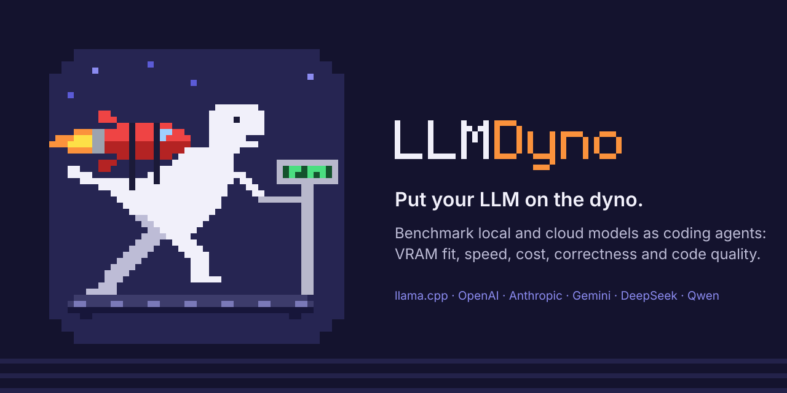
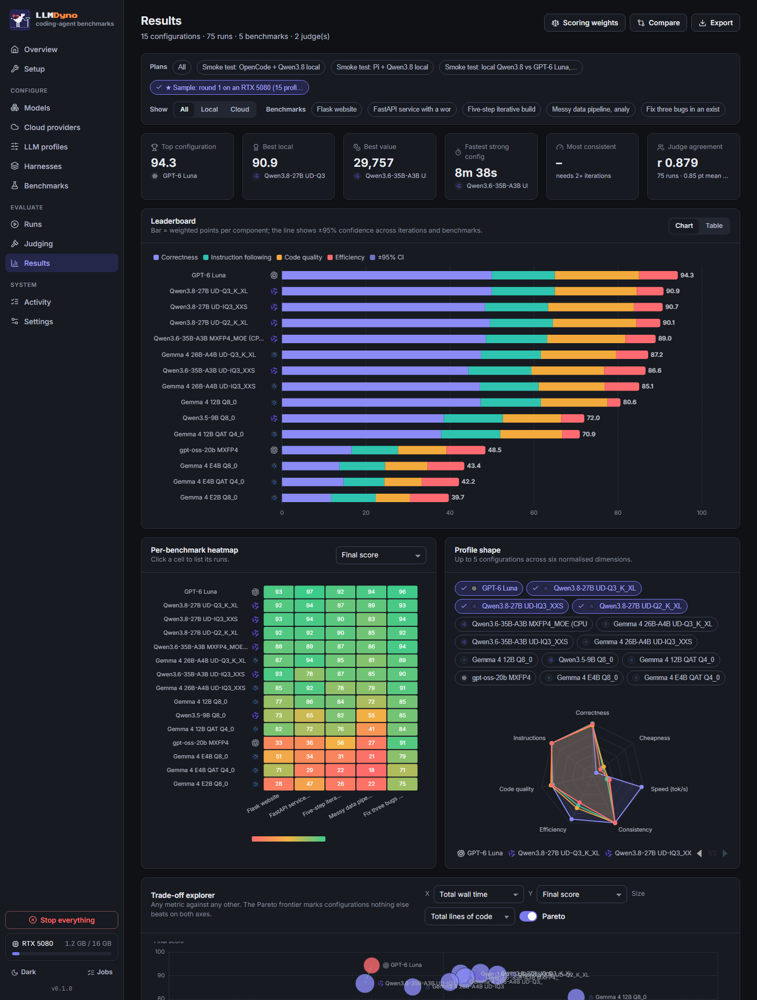
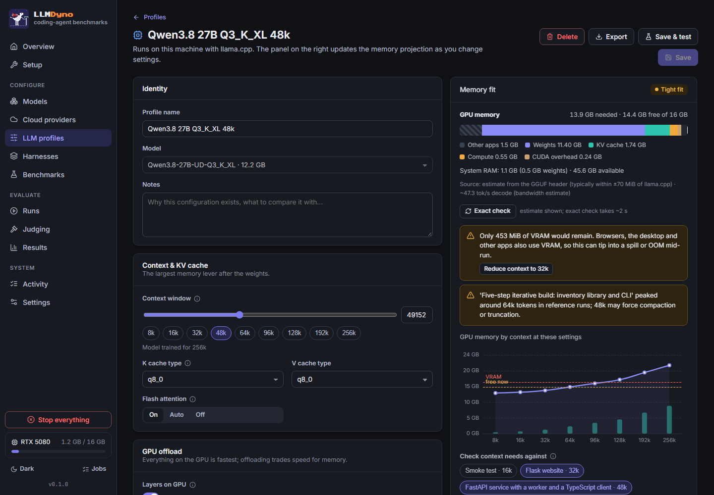
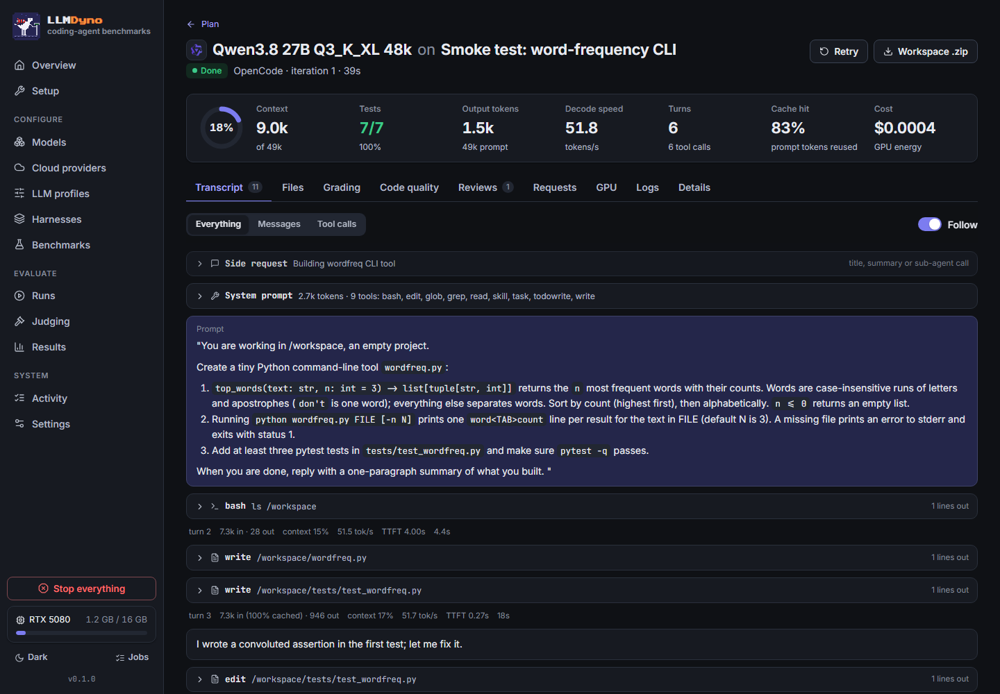
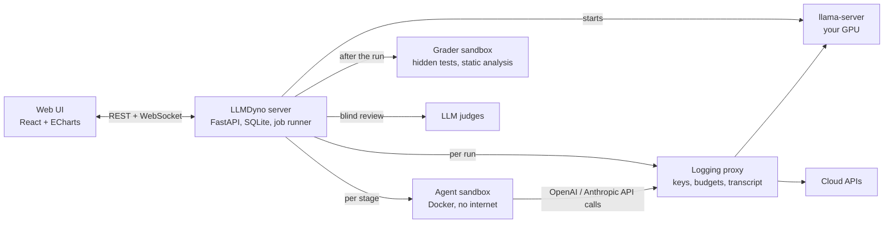

<p align="center">
  
</p>

<p align="center">
  <a href="https://github.com/speak2jerome/llmdyno/actions/workflows/ci.yml"></a>
  <a href="https://github.com/speak2jerome/llmdyno/releases"></a>
  <a href="LICENSE"></a>
  
  
</p>

# LLMDyno

**LLMDyno is an open-source benchmark for running local and cloud LLMs as coding agents.** You pick models (GGUF files
through llama.cpp on your own GPU, or APIs such as OpenAI, Anthropic, Gemini, DeepSeek, Kimi and Qwen), pick an agent
harness (Pi, OpenCode, Codex CLI, Qwen Code, Crush, Aider, mini-SWE-agent), and LLMDyno runs real multi-file coding
tasks in offline Docker sandboxes. Hidden tests grade the result, LLM judges review the code blind, and a dashboard
compares correctness, code quality, speed, VRAM and cost.

It's a dyno for models: it measures what a model actually does on your machine, with your settings, rather than what
a leaderboard says it does on someone else's.

<p align="center"></p>

## Contents

- [Why LLMDyno](#why-llmdyno)
- [Features](#features)
- [Quick start](#quick-start)
- [Round 1 results: 15 configurations on an RTX 5080](#round-1-results-15-configurations-on-an-rtx-5080)
- [How it works](#how-it-works)
- [Supported harnesses, providers and hardware](#supported-harnesses-providers-and-hardware)
- [FAQ](#faq)
- [Contributing](#contributing) · [Releases and versioning](#releases-and-versioning) · [License](#license)

## Why LLMDyno

Public leaderboards answer "which model is best on a datacenter GPU at full precision". If you run models locally,
the questions that matter are different:

- **Does it fit?** A 27B model at 3 bits with a 48k context either fits in 16 GB of VRAM or it doesn't. On Windows,
  "doesn't" often means the driver quietly spills into system RAM and runs 5-20x slower without an error.
- **Which quant, which context, which KV cache type?** Q2 vs Q3 vs IQ3, f16 vs q8_0 cache, experts on the CPU or not.
- **Does it work as an agent?** Tool calling, multi-step edits and running tests matter more than one-shot answers.
- **How does it compare with the API I'd otherwise pay for**, per task, in dollars and minutes?

LLMDyno answers those with your hardware, your models and your settings, and keeps every transcript so you can see why
a model failed.

## Features

**Hardware-aware setup**
- Detects CPU (AVX2/AVX-512), RAM, NVIDIA/AMD/Intel GPUs, driver, CUDA version, disks and Docker on x86-64 Windows and Linux.
- Installs a matching prebuilt [llama.cpp](https://github.com/ggml-org/llama.cpp) build (CUDA 12/13, Vulkan, ROCm, SYCL or CPU), or uses yours.

**Models and memory fit**
- Search Hugging Face, check the fit before you download, then download with resume and SHA-256 verification.
- A VRAM projection from the GGUF header alone: weights per layer, KV cache (sliding-window, shared-KV, hybrid
  recurrent and MLA layers), compute buffers and CUDA overhead. Checked against `llama-fit-params`: mean error -4 MiB,
  worst case 66 MiB across 84 configurations.
- Warnings before you run: out of memory, **VRAM spilling into shared memory**, CPU offload, context shorter than the
  task needs, risky KV quantization, missing tool-calling support. Most come with a one-click fix.



**LLM profiles**: a model plus its exact settings (context, KV cache, offload, MoE experts on CPU, sampling, reasoning).
A quick test loads the model and measures real VRAM, decode speed and tool calling in about 20 seconds.

**Cloud providers**: OpenAI, Anthropic, Google Gemini, DeepSeek, Moonshot (Kimi), Z.ai, Qwen, MiniMax, xAI, Mistral,
OpenRouter, Groq, Together, Fireworks, Cerebras, or any OpenAI-compatible endpoint. Keys are encrypted at rest and
never enter a sandbox. Spend caps per provider and per plan are enforced by a proxy, so a looping agent can't run up a bill.

**Agent harnesses**: seven open-source harnesses in offline Docker sandboxes, each run against the same tasks, plus
custom harnesses from a JSON manifest. A proxy records every request, so transcripts (thinking, tool calls, results)
look the same whichever harness ran.



**Benchmarks**: six built-in tasks with hidden tests (a CLI smoke test, a Flask site, a FastAPI service with a
TypeScript client, a five-stage iterative build, a data pipeline with a churn model, and a bug-fix task). Write your
own in the editor; a validator checks that the starter fails and the reference passes.

**Plans**: profiles × harnesses × benchmarks × iterations. Preflight checks compatibility, memory and budget; local
runs share the GPU one model at a time while cloud runs go in parallel. Pause, resume, retry and cancel at any point.

**Judging**: blind, shuffled LLM code review with an editable rubric and as many judges as you like, local or cloud.
LLMDyno reports how much the judges agree and whether a judge favours its own vendor's models.

**Results dashboard**: weighted leaderboard with 95% confidence intervals, per-benchmark heatmap, radar profiles, a
cost/speed/quality scatter with the Pareto front, consistency (pass@k, pass^k), token use, harness comparison, rubric
heatmap, side-by-side compare, and CSV/JSON export. Vendor and model-family logos everywhere.

**Panic stop**: one red button (or Ctrl+Shift+X) cancels every run and job, removes every sandbox and proxy container
and kills llama-server, after a confirmation.

**A mascot with a job**: the pixel dino sprints on its treadmill while a benchmark runs, sits on the podium while
judges deliberate, and freezes red on a panic stop. The browser tab icon and title follow along, so you can see
progress from another tab.

<p align="center">
  
  
</p>

## Quick start

**Requirements**: Windows 10/11 or Linux on x86-64, Python 3.11+, and Docker (Docker Desktop on Windows). An NVIDIA,
AMD or Intel GPU is recommended for local models; cloud-only use works without one.

```bash
git clone https://github.com/speak2jerome/llmdyno.git
cd llmdyno
```

Windows (PowerShell):

```powershell
powershell -ExecutionPolicy Bypass -File setup.ps1
```

Linux:

```bash
./setup.sh
```

The setup script creates a virtual environment, installs LLMDyno and starts it at <http://127.0.0.1:8777>. The
first-run wizard checks your system, installs llama.cpp and builds the sandbox images. To start it again later:

```bash
.venv/bin/llmdyno serve --open        # Windows: .venv\Scripts\llmdyno serve --open
```

Want to look around first? **Settings → Sample results** loads the round-1 study below, so the dashboard has data
before you run anything.

Other commands: `llmdyno doctor` (check dependencies), `llmdyno specs` (print the detected hardware),
`llmdyno --version`. Data lives in `./data` inside the checkout (or `%LOCALAPPDATA%\LLMDyno` / `~/.local/share/llmdyno`
for a pip install), or wherever `LLMDYNO_DATA` points.

## Round 1 results: 15 configurations on an RTX 5080

Five agentic tasks, the Pi harness, one iteration per task, judged blind by two models. Local models ran fully on an
RTX 5080 (16 GB) with llama.cpp; nothing spilled into system memory. Scores are out of 100: 50% hidden-test
correctness, 15% instruction following, 25% code quality (static analysis, behaviour probes and judge reviews) and
10% efficiency. The full data ships with LLMDyno as the sample results.

| # | Configuration | Score | Correct | Quality | Decode tok/s | Wall time (5 tasks) | Peak VRAM |
|---|---|---|---|---|---|---|---|
| 1 | GPT-6 Luna (API) | **94.3** | 100% | 80 | 181 | 9 min | cloud |
| 2 | Qwen3.8 27B UD-Q3_K_XL | **90.9** | 100% | 78 | 53 | 23 min | 14.9 GB |
| 3 | Qwen3.8 27B UD-IQ3_XXS | 90.7 | 97% | 82 | 60 | 19 min | 14.6 GB |
| 4 | Qwen3.8 27B UD-Q2_K_XL | 90.1 | 99% | 80 | 63 | 26 min | 13.3 GB |
| 5 | Qwen3.6 35B-A3B MXFP4 (experts on CPU) | 89.0 | 97% | 74 | 75 | 20 min | 14.7 GB |
| 6 | Gemma 4 26B-A4B UD-Q3_K_XL | 87.2 | 95% | 72 | 143 | 18 min | 14.8 GB |
| 7 | Qwen3.6 35B-A3B UD-IQ3_XXS | 86.6 | 89% | 69 | 163 | 9 min | 14.6 GB |
| 8 | Gemma 4 26B-A4B UD-IQ3_XXS | 85.1 | 94% | 63 | 157 | 13 min | 14.6 GB |
| 9 | Gemma 4 12B Q8_0 | 80.6 | 95% | 64 | 55 | 51 min | 15.2 GB |
| 10 | Qwen3.5 9B Q8_0 | 72.0 | 77% | 55 | 81 | 25 min | 12.7 GB |
| 11 | Gemma 4 12B QAT Q4_0 | 70.9 | 76% | 59 | 86 | 36 min | 9.8 GB |
| 12 | gpt-oss-20b MXFP4 | 48.5 | 33% | 46 | 178 | 10 min | 14.5 GB |
| 13 | Gemma 4 E4B Q8_0 | 43.4 | 27% | 40 | 110 | 11 min | 8.5 GB |
| 14 | Gemma 4 E4B QAT Q4_0 | 42.2 | 29% | 36 | 132 | 12 min | 6.3 GB |
| 15 | Gemma 4 E2B Q8_0 | 39.7 | 23% | 33 | 187 | 9 min | 5.1 GB |

What stood out:

- **A 16 GB card got within 3.4 points of a frontier API.** Qwen3.8 27B at 3 bits passed every hidden test on all
  five tasks. It took 23 minutes against the API's 9, for about a cent of electricity.
- **For the 27B dense model, the quant barely mattered.** Q3_K_XL, IQ3_XXS and even Q2_K_XL landed within 0.8 points
  of each other. At 12B it mattered a lot: Gemma 4 12B dropped from 80.6 (Q8_0) to 70.9 (QAT Q4_0).
- **Speed and quality are separate axes.** gpt-oss-20b and Gemma 4 E2B decode at 178-187 tok/s and fail most tasks.
  The fastest strong local option was the Qwen3.6 35B-A3B MoE: nine minutes for 86.6.
- **For the MoE, a bigger quant with experts in system RAM beat a smaller quant on the GPU.** Qwen3.6 35B-A3B in
  MXFP4 with the experts on the CPU: 97% correct at 75 tok/s. The same model in IQ3_XXS, fully on the GPU: 89% at
  163 tok/s.
- **Small models fall apart on agentic work.** Gemma 4 E2B and E4B passed about a quarter of the hidden tests; the
  9B Qwen managed 77%.
- **The judges agreed.** Claude and GPT-6 Luna scored the same 75 runs with a correlation of 0.879 (mean gap 0.85
  on a 10-point scale). Luna showed no self-preference: relative to Claude it was, if anything, 0.5 points harder
  on its own model's runs.

These are five tasks with one iteration each, so treat single-digit gaps as noise. LLMDyno reports confidence
intervals once you run more iterations.

## How it works



- The agent's sandbox has no network except a private Docker network to its own proxy. The proxy holds the real API
  key, enforces spend caps, fixes chat-template quirks for local models and writes a harness-neutral transcript.
- Hidden tests and code-quality probes run in a separate sandbox after the agent finishes, so the agent never sees them.
- Everything runs as one Python process with SQLite; Docker is only used for the sandboxes.

More detail: [docs/ARCHITECTURE.md](docs/ARCHITECTURE.md). Adding things: [harnesses](docs/HARNESSES.md),
[benchmarks](docs/BENCHMARKS.md).

## Supported harnesses, providers and hardware

| Harness | Version | APIs | Notes |
|---|---|---|---|
| [Pi](https://github.com/earendil-works/pi) | 1.4.0 | OpenAI Chat, Responses, Anthropic | minimal coding agent |
| [OpenCode](https://opencode.ai) | 1.19.4 | OpenAI Chat, Responses, Anthropic | terminal agent with sessions |
| [Codex CLI](https://github.com/openai/codex) | 0.164.0 | Responses | OpenAI's agent |
| [Qwen Code](https://github.com/QwenLM/qwen-code) | 0.26.1 | OpenAI Chat | Gemini CLI fork for Qwen |
| [Crush](https://github.com/charmbracelet/crush) | 0.98.2 | OpenAI Chat, Anthropic | Charm's Go agent |
| [Aider](https://aider.chat) | 0.86.2 | OpenAI Chat | edits from replies, works without tool calls |
| [mini-SWE-agent](https://mini-swe-agent.com) | 2.4.6 | OpenAI Chat | one bash tool |
| Custom | any | any | JSON manifest: image, config files, command |

**Providers**: OpenAI, Anthropic, Google Gemini, DeepSeek, Moonshot (Kimi), Z.ai (GLM), Qwen (DashScope), MiniMax,
xAI, Mistral, OpenRouter, Groq, Together, Fireworks, Cerebras, and any OpenAI-compatible URL (vLLM, LM Studio, Ollama).

**Hardware**: x86-64 only for now (Windows 10/11, Linux). NVIDIA CUDA 12/13, AMD ROCm or Vulkan, Intel SYCL or
Vulkan, or CPU-only. Apple Silicon and ARM are on the roadmap.

## FAQ

### What is LLMDyno?
A local web app that benchmarks LLMs as coding agents. It runs open-source agent harnesses against coding tasks with
hidden tests, on local models (llama.cpp) or cloud APIs, and compares correctness, code quality, speed, VRAM and cost.

### How is it different from SWE-bench or Aider's leaderboard?
Those publish fixed results for fixed setups. LLMDyno is a tool you run yourself, so you can test the exact quant,
context size, KV cache and harness you'd actually use, on your own GPU, and compare them with cloud models on equal terms.

### Will my model fit in VRAM?
LLMDyno estimates it from the GGUF header before you download, and checks it exactly with `llama-fit-params` once the
file is on disk. It warns about out-of-memory, spilling into shared memory, CPU offload and context limits, and
re-checks free VRAM right before each model loads, because browsers and games use VRAM too.

### What is "VRAM spilling" and why does it matter?
On Windows, NVIDIA drivers move GPU memory into system RAM when VRAM runs out (Sysmem Fallback) instead of failing.
The model keeps working, 5-20x slower, so benchmark numbers quietly become wrong. LLMDyno watches the shared-memory
counters during runs and flags affected results.

### Can a runaway agent run up my API bill?
Each provider and each plan has a hard budget. The proxy between the agent and the API refuses requests once the
budget is reached, and it counts spend even for requests that are cut off mid-stream. The panic stop halts everything.

### Are my API keys safe?
Keys are encrypted at rest (Windows DPAPI; file permissions on Linux) and only the per-run proxy container receives
one. Agents get a placeholder key and have no internet access.

### Which harness should I use?
Run the same models through several and compare; the dashboard has a harness comparison chart. In our smoke tests
Pi, OpenCode, Qwen Code, Aider and mini-SWE-agent each passed 7/7 hidden tests with Qwen3.8 27B, and Crush and
Codex CLI passed 6/7.

### Can I add my own benchmark?
Yes. Use the editor in the app, or write a folder with a prompt, starter files, hidden tests and an optional
reference solution. See [docs/BENCHMARKS.md](docs/BENCHMARKS.md).

### Does it work without a GPU?
Yes, for cloud models. Local models also run on the CPU, but agentic tasks with long contexts will be very slow, and
LLMDyno tells you so up front.

## Contributing

Bug reports, new benchmarks, harness adapters and provider presets are welcome. See [CONTRIBUTING.md](CONTRIBUTING.md).
Please report security issues privately as described in [SECURITY.md](SECURITY.md).

## Releases and versioning

LLMDyno follows [Semantic Versioning](https://semver.org). It is in the 0.x series: minor releases may change the API,
data layout or database schema (with automatic migrations), and patch releases only fix bugs. Every run records the
LLMDyno version that produced it, and exports carry it in the file name. See [CHANGELOG.md](CHANGELOG.md) and
[docs/RELEASING.md](docs/RELEASING.md).

## License

MIT, see [LICENSE](LICENSE). Third-party components and trademarks are listed in [NOTICE.md](NOTICE.md). If you use
LLMDyno in research, please cite it ([CITATION.cff](CITATION.cff)).
