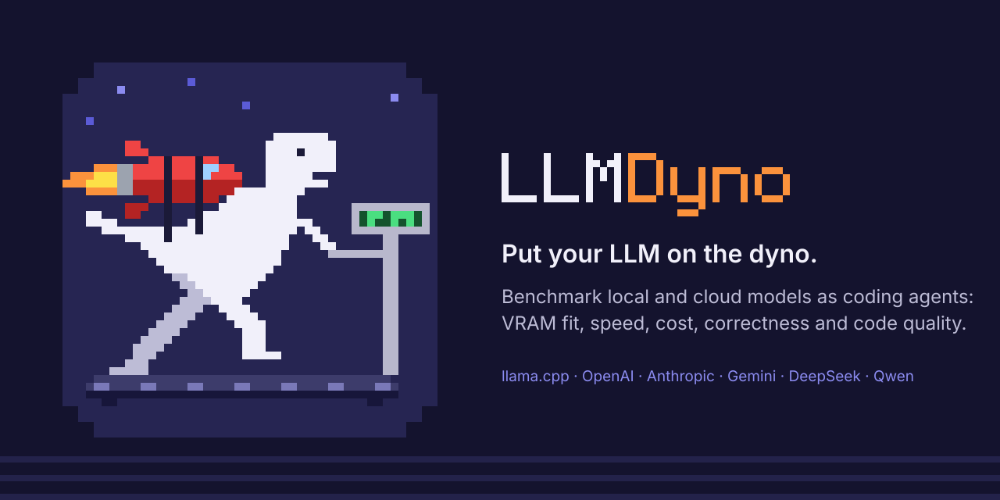

# LLMDyno



LLMDyno benchmarks local (llama.cpp) and cloud LLMs as **coding agents**. Real agent harnesses (Pi, OpenCode, Codex
CLI, Qwen Code, Crush, Aider, mini-SWE-agent, or your own) work on real tasks in offline Docker sandboxes, behind a proxy
that records every request and enforces budgets. The results come from four sources: hidden tests, static analysis,
behaviour probes and blind LLM judges. Before a local model downloads, LLMDyno tells you whether it will fit in your
GPU's memory.

It is a web dashboard, a Python library and a command line, all working on the same data.

```bash
pip install llmdyno
llmdyno serve --open
```

```python
import llmdyno

gpt = llmdyno.cloud_model("openai", "gpt-6-luna", reasoning_effort="low", budget_usd=2)
qwen = llmdyno.local_model("unsloth/Qwen3.8-27B-GGUF", quant="UD-Q3_K_XL", ctx=49152)
results = llmdyno.bench([gpt, qwen], benchmarks="suite_quick", harnesses="pi")
print(results)
results.plot.leaderboard()
```


## Where to go next

- **[Python library and CLI](LIBRARY.md)**: everything the dashboard does, from code or a terminal.
- **[Integrations](INTEGRATIONS.md)**:
    - pandas and polars, notebooks and charts;
    - MLflow, Weights & Biases, Langfuse and OpenTelemetry;
    - LiteLLM and Ollama, and the Hugging Face Hub;
    - your own LangGraph or other agent, Inspect AI, and pytest and CI.
- **[Remote mode](REMOTE.md)**: run it on the GPU box, drive it from your laptop.
- **[Benchmarks](BENCHMARKS.md)** and **[Harnesses](HARNESSES.md)**: what is measured, and how to add your own.
- **[API reference](reference/index.md)**: every public call, generated from the code.

Source, issues and releases: [github.com/speak2jerome/llmdyno](https://github.com/speak2jerome/llmdyno).
